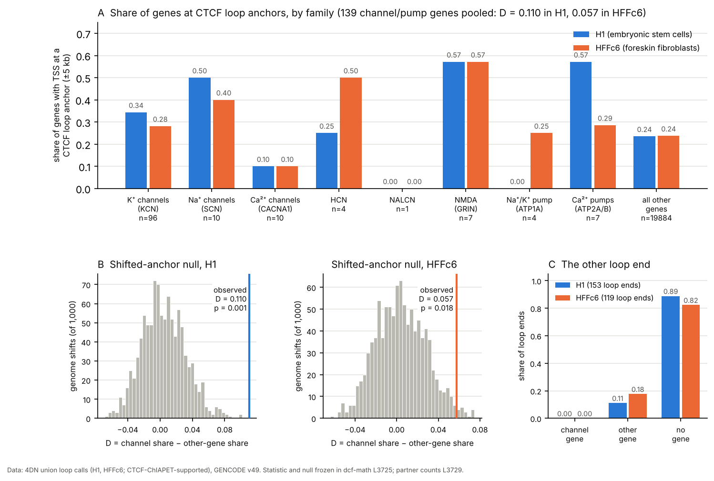

# Nerve-metal genes sit at CTCF loop anchors in human stem cells and fibroblasts: pre-registered tests on the 4D Nucleome union loops
### Manuscript 3, draft v0.4 · Gary NOMEREMORTAL Mason · Digital Cosmos Framework · 18 November 2026
*Draft for internal review. Every number is taken from a committed output in `dcf-math/rounds/` (L3705–L3729). Pre-registrations are hashed in `preregistrations/LEDGER.md`.*

## Abstract
**Background:** CTCF is an 11-zinc-finger protein that, with cohesin, anchors chromatin loops.

**What we asked:** where do the genes for the nervous system's "metal battery" sit in the 3D genome of non-neural human cells? The gene set covers voltage-gated K, Na and Ca channels, HCN, NALCN, NMDA receptors, and the Na/K and Ca ATPases (139 genes).

**Data:**
- **Loops:** the 4D Nucleome union loop sets for H1 embryonic stem cells (141,365 loops) and HFFc6 fibroblasts (146,140 loops).
- **Genes:** GENCODE v49.

**Design:** every test was frozen and hashed before running.

**Main results:**
- **Active-promoter loops:** as predicted, nerve-metal genes have fewer active-promoter (H3K4me3) loops. The odds ratio is 0.33 in fibroblasts (p = 2 × 10⁻¹⁰) and 0.72 in stem cells (p = 0.04).
- **CTCF loop anchors (unexpected):** nerve-metal genes sit at CTCF anchors *more* often than other genes: 34.5% vs 23.5% in stem cells (OR 1.72) and 29.5% vs 23.7% in fibroblasts.
- **Robustness:** the excess survives length matching (OR 1.73), and other neural genes do not share it. It survives a genome-shift permutation that preserves gene clustering and loop structure: **p = 0.001 (H1) and p = 0.018 (HFFc6).**
- **Where these loops lead:** none joins two channel genes, and **most (89% in H1) end in non-gene DNA.**
- **A third, neural cell type (blind, L3825; 4 of 4):** in SK-N-SH neuroblastoma CTCF ChIA-PET loops (ENCODE), the excess holds: D = 0.100, p = 0.001. Potassium channels and NMDA receptors sit at anchors more often than other genes, and **voltage-gated calcium channel genes again sit there less often**, as in H1 and HFFc6.

**Interpretation:** the nervous system's metal-handling genes are held in CTCF-anchored structures in stem cells, fibroblasts and a neural line. Because the pattern also appears in neural-like cells, it is not limited to cells where the genes are silent; a purely "poised" reading is weakened. Calcium channel genes are the consistent exception.

## 1. Introduction
- **Ion selectivity:** neurons signal by moving Na⁺, K⁺ and Ca²⁺ through channels, and restore the gradients with ATP-driven pumps. Earlier work in this series (Manuscript 2) read the metal-selecting loops of these proteins from sequence across animals.
- **Genome folding:** the 4D Nucleome project has produced reference loop maps for human cells. The project calls the dimension of change over time its "fourth" dimension. Loop anchors are dominated by CTCF, whose DNA binding uses 11 zinc fingers.
- **Evolutionary context (this series, L3701 and L3713):**
  - CTCF is absent from every non-bilaterian proteome tested (sponges, placozoans, cnidarians, the comb jelly and four single-celled relatives).
  - It is found in most bilaterians.
  - **Sensitivity:** the CTCF finder detected 4 of 4 development controls. Generic absence finders on UniProt sets have about 79% per-gene sensitivity (cohesin control, L3713).
    - **The non-bilaterian absence holds:** if CTCF were present and missed independently at 21%, all 14 non-bilaterians would be missed with probability about 3 × 10⁻¹⁰.
    - **Individual bilaterian absences are "not detected".** A relaxed finder (v2, development) recovers CTCF in six of them (L3713).
- **Question:** are nerve-metal genes placed differently from other genes in the 3D genome of cells that do not use them?

## 2. Methods
### 2.1 Data
**Loops:** Zenodo record 17451616, union loops for H1-hESC and HFFc6 (GRCh38).
- **Integrity:** MD5 verified, `6b186943…` and `1faf1181…`.
- **Validation of the external report:** every audit number in an external report about these files was recomputed independently and reproduced exactly (L3705).
- **Labels:** each loop carries one or more platform labels (CTCF-ChIAPET, H3K4me3-PLACSeq, RNAPII-ChIAPET, Hi-C, Micro-C). There are no trans loops.

**Genes:** GENCODE v49 basic (2025-07-08), protein-coding genes on the autosomes and X (20,014 by name; 20,023 entries).
- **TSS:** the gene start (+ strand) or end (− strand).

### 2.2 Gene sets
- **Nerve-metal set (139):** gene names matching KCN*, SCN*A, CACNA1*, HCN1–4, NALCN, GRIN*, ATP1A1–4, ATP2A1–3 and ATP2B1–4. Auxiliary K-channel subunits (KCNAB, KCNE, KCNIP) are included by the pattern.
- **Neural non-channel set (50):** NRXN, NLGN, CNTNAP, CNTN, LRRTM, SHANK, DLG, SYN and SYT families.
- **Controls:** all other protein-coding genes.

### 2.3 Tests (each pre-registered)
1. **L3713/L3717, anchor occupancy:** a gene is anchored if its TSS ± 5 kb overlaps an anchor of a loop with the given label. One-sided Fisher tests.
2. **L3721, robustness and specificity:**
   - cluster-merged units (a flawed design, see §3.2);
   - the neural non-channel set;
   - 10 length-matched controls per gene.
3. **L3725, genome-shift permutation:**
   - **Statistic:** D = channel anchored share − control anchored share.
   - **Null:** 1,000 shuffles. Each shifts all CTCF anchors on a chromosome by one random offset (circular), seed 3725.
4. **L3729, loop partners:** for CTCF loops anchored at a nerve-metal TSS, the other anchor is classed as another channel gene, another protein-coding TSS, or neither.

## 3. Results
### 3.1 Active-promoter loops are reduced, CTCF anchors are increased (L3717; 3 of 4 predictions)
| cells | loop label | nerve-metal genes | other genes | OR | p |
|---|---|---|---|---|---|
| H1 | CTCF-ChIAPET | 34.5% | 23.5% | 1.72 | 0.002 (predicted *not* enriched: failed) |
| HFFc6 | CTCF-ChIAPET | 29.5% | 23.7% | 1.34 | 0.07 |
| H1 | H3K4me3-PLACSeq | 63.3% | 70.6% | 0.72 | 0.04 (depletion predicted) |
| HFFc6 | H3K4me3-PLACSeq | 33.8% | 60.5% | 0.33 | 2 × 10⁻¹⁰ (depletion predicted) |

**By family (H1 CTCF anchors):**
- NMDA receptors: 57%;
- Na channels: 50%;
- pumps: 36%;
- K channels and subunits: 34%;
- CaV α1: 10%.

### 3.2 Not length, not neural-wide (L3721; 1 of 3)
- **Length:** the excess persists against 10 length-matched controls per gene (34.5% vs 23.4%, OR 1.73, p = 0.003).
- **Specificity:** non-channel neural genes show no excess (24.0% vs 23.5%).
- **The cluster-merged test failed:** OR 1.10, p = 0.33. Its design merged genes within each set, so control units bundled many genes and had more chances to hit an anchor. **It is reported as failed.**
- **Descriptive split:** among genes sharing a 100-kb neighbourhood with other genes, the excess appears in both cells (OR 1.93 and 1.82). This view was chosen after seeing P1.

### 3.3 The excess survives a cluster-preserving permutation (L3725; 2 of 2)
| cells | observed D | null mean ± sd | p |
|---|---|---|---|
| H1 | 0.110 | 0.004 ± 0.027 | **0.001** |
| HFFc6 | 0.057 | 0.004 ± 0.024 | **0.018** |

### 3.4 Where the loops lead (L3729; 2 of 2)
- **H1:** 0 of 153 channel-anchored CTCF loop ends reach another channel gene. Only 11% reach any protein-coding TSS, against 27% for control-anchored loops (OR 0.34).
- **HFFc6:** 0 of 119 reach another channel gene; 18% reach a TSS, against 27%.
- **Most loops from nerve-metal genes end in non-gene DNA.**

### 3.5 A neural cell line (L3825; 4 of 4, blind)
**Data:** ENCODE CTCF in-situ ChIA-PET in SK-N-SH (ENCSR514HBO, Ruan lab). No pooled loop file exists, so by the frozen rule the larger replicate was used: ENCFF775DIU, 1,271,184 loops (PET ≥ 3). The strongest 28,270 loops by PET count were kept, the H1 CTCF-tagged density (amendment made before data; PET ≥ 25 at the cut).

| family | n | SK-N-SH | H1 | HFFc6 |
|---|---|---|---|---|
| K⁺ channels (KCN) | 96 | **0.44** | 0.34 | 0.28 |
| Na⁺ channels (SCN) | 10 | 0.50 | 0.50 | 0.40 |
| **Ca²⁺ channels (CACNA1)** | 10 | **0.20** | 0.10 | 0.10 |
| NMDA receptors (GRIN) | 7 | **0.57** | 0.57 | 0.57 |
| all other genes | 19,884 | 0.33 | 0.24 | 0.24 |

- **Pooled:** D = 0.100, genome-shift p = 0.001 (N1).
- **Predictions:** KCN above (N2), GRIN above (N3) and CACNA1 below (N4) the all-other share. All pass.
- **Replicate 1** (ENCFF072FCN, descriptive): D = 0.073, p = 0.011, with the same three family directions.
- **Calcium channels are below the genome-wide share in all three cell types,** but there are only 10 genes.

### Figure 1

**Figure 1. Nerve-metal genes at CTCF loop anchors.**
- **(A)** Share of genes whose transcription start site (± 5 kb) lies at a CTCF-ChIA-PET-supported loop anchor, by family, in H1 (blue) and HFFc6 (orange). The pooled excess (D = 0.110 and 0.057) is carried mostly by potassium and sodium channels, NMDA receptors and the calcium pumps. Calcium channels (0.10) and NALCN (0 of 1) sit below the genome-wide share (0.24). Several families have fewer than 10 genes.
- **(B)** Genome-shift null for D: every anchor on a chromosome is shifted by one common random offset, 1,000 times (seed 3725). Observed D is the vertical line.
- **(C)** The other end of each channel-anchored loop: none reaches another channel gene, and most reach no gene at all.

Source: `figures/L3821_manuscript3.py`, which recomputes the frozen L3725 null and stops unless its summary matches `rounds/L3725_tool_output.txt` exactly.

## 4. Discussion
**What the data show:**
- Genes for neuronal metal handling are depleted of active-promoter loops in non-neural cells, as expected for silent genes.
- Yet they are enriched at CTCF anchors. That holds:
  - in two cell types;
  - under a permutation that keeps genome structure;
  - with no shared excess among other neural genes.
- Their CTCF loops mostly connect to non-gene DNA, not to other genes or to each other.

**A possible interpretation:**
- CTCF-anchored loops may insulate these genes, or keep them in pre-formed domains.
- This could be a "poised" architecture that awaits activation in excitable cells.
- **SK-N-SH (L3825) shows the excess in a neural-like line as well,** so it is not specific to silent states. Loop maps from mature neurons or muscle remain the decisive test.

**Limitations:**
- Three cell types: two non-neural and one neuroblastoma (cancer) line.
- One loop-calling union per cell, with platform labels as given.
- A TSS window of ± 5 kb.
- Gene-name patterns, so auxiliary subunits are included.
- One robustness test failed by design.
- **Association, not mechanism.**

**Evolutionary context (descriptive):**
- CTCF itself appears with the bilaterians in the proteomes tested (L3701; finder sensitivity limits in L3713).
- So did the lysine sodium channel and NR1 in this series (Manuscript 2).

## 5. Data and code availability
- **Data:** Zenodo 17451616 (loops) and GENCODE v49 (genes).
- **Code:** `dcf-math/rounds/` scripts L3713–L3729.
- **Records:** pre-registrations and ledger in `dcf-math/preregistrations/`.
- **Archive:** dcf-math v1.2.0, DOI 10.5281/zenodo.24331499 (all versions: 10.5281/zenodo.24234794); dcf-genefinder v1.2.0, DOI 10.5281/zenodo.24331605 (all versions: 10.5281/zenodo.24234985).

## Declarations
- **Pre-registration:** every graded prediction was hashed before running. **Failed predictions are reported and not regraded.**
- **External text:** an external LLM-generated report about these data was treated as untrusted and checked number by number (L3701, L3705).
- **AI assistance:** analyses were carried out with Claude (Anthropic).

## Summary
- **First draft of a short third paper:** in human stem cells and fibroblasts, the genes for the nervous system's metal battery have fewer active-promoter loops but more CTCF (zinc-finger) loop anchors than other genes.
- **The excess survives length matching and a cluster-preserving permutation,** and other neural genes do not share it.
- **Its loops mostly reach non-gene DNA.**
- **The excess repeats blind in a neural line (SK-N-SH, 4 of 4),** and calcium channel genes are below baseline in all three cell types.

## Potential leads for future research
- **[Calcium channel exception]** CACNA1 is below baseline in all three cell types (10 genes). Add the auxiliary subunits (CACNB, CACNA2D, CACNG) as a larger, pre-registered set.
- **[Neurons]** Loop maps from mature (iPSC-derived) neurons; SK-N-SH is a cancer line.
- **[More ENCODE cell types]** ENCODE has CTCF ChIA-PET in about a hundred biosamples. A pre-registered multi-cell test of N1–N4 is possible with the same script.
- **[Partner regions]** Are the non-gene partner anchors enhancers (H3K27ac) or insulators? This needs ENCODE annotations for H1/HFFc6.
- **[Outside reader]** As with Manuscripts 1 and 2.
