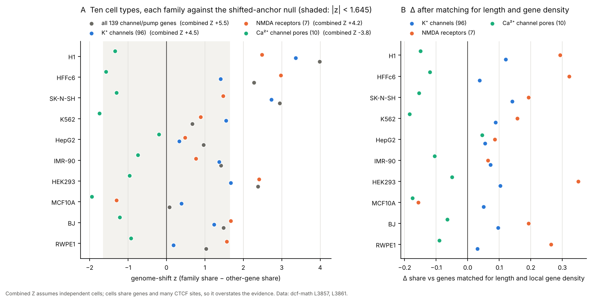
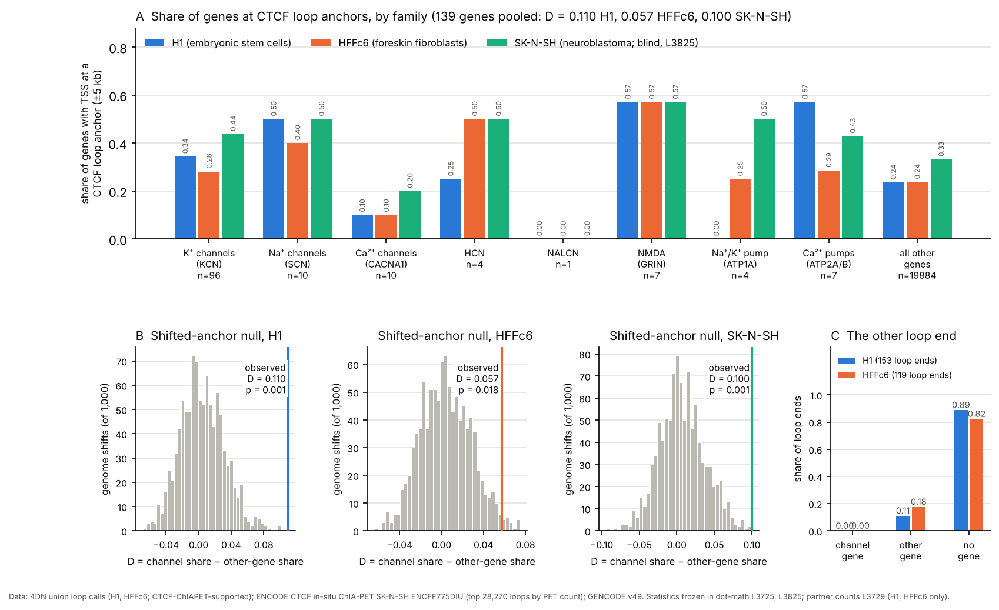

# Pore-forming potassium-channel genes sit at CTCF-bound chromatin loop anchors across human cells and tissues: a pre-registered report
### Manuscript 3, draft v2.5 · Gary NOMEREMORTAL Mason · Digital Cosmos Framework · 21 November 2026
*Draft for internal review. Every number is taken from a committed output in `dcf-math/rounds/` (L3705–L3893). Every test was frozen and hashed before running (`preregistrations/LEDGER.md`), and every failure is reported.*

## Abstract
**Question:** do the genes for the nervous system's ion channels and pumps (139 genes: voltage-gated K⁺, Na⁺ and Ca²⁺ channels, HCN, NALCN, NMDA receptors, Na⁺/K⁺ and Ca²⁺ ATPases) sit at CTCF-anchored chromatin loop ends more often than other genes?

**Data:** fifteen human CTCF loop maps:
- 4D Nucleome union loops for H1 and HFFc6;
- ENCODE CTCF in-situ ChIA-PET (Ruan lab) for SK-N-SH, K562, HepG2, IMR-90, HEK293, MCF 10A, BJ and RWPE1, and five primary CD4⁺ T-cell sets;
- GENCODE v49 genes.

**Discovery (two cells, L3717–L3725):** the excess was found in H1 and HFFc6 (34.5% vs 23.5% of genes at anchors in H1; genome-shift p = 0.001 and 0.018).

**Extension (eight more cell lines, blind, L3825–L3849):**
- the pooled excess was positive in all 10 cell types but significant alone in only 4;
- K⁺ channel genes were above other genes in 10 of 10.

**Controls:**
- **Length and density:** the excess survives matching for gene length and local gene density (L3853, L3861).
- **Dependence-aware test (L3869):** resamples genes and scores all ten cells together. Across the ten, **all 139 genes p = 0.002; K⁺ channels p = 0.008.** NMDA receptors (p = 0.09) and Ca²⁺ channel pores (p = 0.08) are not established.
- **Spread:** the K⁺ excess is shared by all four pore-forming subfamilies, not their auxiliary subunits (L3873).

**Confirmation failed (L3877, blind):** in five primary CD4⁺ T-cell maps the same frozen test found **no excess** (K⁺ p = 0.58; all genes p = 0.72).

**Primary non-immune cells and motor neurons (L3881, blind, 4 of 4):**
- **HUVEC and HMEC (primary, CTCF ChIA-PET):** no excess (K⁺ p = 0.36), as predicted.
- **Three iPSC-derived motor-neuron Hi-C maps:**
  - K⁺ channels 0.198 vs 0.131 (p = 0.009);
  - all 139 genes p = 0.011;
  - pore-forming K⁺ p = 0.0009;
  - auxiliary K⁺ subunits below their null.

**Primary astrocytes (L3889, blind, 2 of 2 gradeable):** cerebellar and spinal-cord astrocytes (in situ Hi-C, Dekker lab):
- K⁺ channels 0.146 vs 0.102 (p = 0.037);
- all 139 genes p = 0.005.

**Tissues (L3893, blind, 2 of 3 gradeable):**
- **Colon tissue Hi-C shows the K⁺ excess** (0.276 vs 0.205, p = 0.028), although no excess was predicted. This failure stands.
- **Skeletal muscle:** not significant (p = 0.18).
- **Heart:** void (no loops released).

**Same cells, different assays (L3897–L3905, H1 + HFFc6, not blind):**
- **CTCF ChIA-PET loops:** pore-forming K⁺ p = 0.015.
- **Hi-C loops overall:** no excess (p = 0.35), even with anchors trimmed to 1 kb (p = 0.36).
- **Micro-C loops:** pore-forming K⁺ p = 0.043.
- **Hi-C loops whose anchors both coincide with CTCF anchors:** the excess returns (pore-forming K⁺ p = 0.013; all 139 p = 0.034).
- **Hi-C loops touching no CTCF anchor:** no excess; the 139 genes sit there *less* often than matched genes (0.137 vs 0.226).
- **So the assay itself does not create or remove the excess; CTCF binding at the anchor does.**

**CTCF-anchored loops in the Hi-C positives (L3909, L3913):**
- Using H1/HFFc6 CTCF sites as a stand-in for shared CTCF binding, CTCF-anchored Hi-C loops carry the excess.
- **Motor neurons, astrocytes and colon:** pore-forming K⁺ 0.154 vs 0.086, p = 0.0008.
- **Skeletal muscle:** 0.203 vs 0.120, p = 0.010. In L3893 it was only weak.
- **The depletion at CTCF-free loops seen in H1/HFFc6 did not repeat** (L3909 C3 failed).

**Same genes everywhere (L3917, 2 of 3):**
- Gene by gene, the K⁺ excess ranks agree between cell lines and Hi-C maps (rho = 0.73).
- They also agree with the primary-cell "negatives" (rho = 0.78). Those maps anchor the same genes; their matched genes simply anchor more often.
- **Seven genes are anchored in every group:** KCNMA1, KCNJ5, KCNQ5, KCNC1, KCNJ11, KCNH1, KCNA2.

**Symmetry (L3885):** channels grouped by pore symmetry (3-, 4-, 5-, 6-fold) show no scaling. The large pentameric receptor family shows no excess.

**Conclusion (revised after L3953):**
- **The excess is present** in ten cell lines (ChIA-PET) and in every Hi-C map tested: motor neurons, astrocytes, colon, and weakly muscle.
- **It is absent in seven primary-cell ChIA-PET maps** (T cells, endothelium, mammary epithelium).
- **But CD4⁺ T-cell Hi-C (L3953) shows it at CTCF-anchored loops** (pore K⁺ p = 0.021). So the T-cell ChIA-PET negatives were an assay effect. The pre-registered cell-type reading failed and is withdrawn. HUVEC/HMEC are untested by Hi-C.
- **The neural-lineage reading (L3889) is withdrawn to "possible".**
- **Within every Hi-C map tested, the excess follows CTCF-bound anchors** (L3905, L3909, L3913, L3953). At non-CTCF loops the genes are at or below matched genes.
- **It is carried by pore-forming K⁺ channel genes,** not their auxiliary subunits.
- **Caveat:** the neuron maps are Hi-C (a different assay) from iPSC-derived cells.

Earlier abstract bullets (v1.1), kept for the record

**Background:** CTCF is an 11-zinc-finger protein that, with cohesin, anchors chromatin loops.

**What we asked:** where do the genes for the nervous system's "metal battery" sit in the 3D genome of non-neural human cells? The gene set covers voltage-gated K, Na and Ca channels, HCN, NALCN, NMDA receptors, and the Na/K and Ca ATPases (139 genes).

**Data:**
- **Loops:** the 4D Nucleome union loop sets for H1 embryonic stem cells (141,365 loops) and HFFc6 fibroblasts (146,140 loops).
- **Genes:** GENCODE v49.

**Design:** every test was frozen and hashed before running.

**Main results:**
- **Active-promoter loops:** as predicted, nerve-metal genes have fewer active-promoter (H3K4me3) loops. The odds ratio is 0.33 in fibroblasts (p = 2 × 10⁻¹⁰) and 0.72 in stem cells (p = 0.04).
- **CTCF loop anchors (unexpected):** nerve-metal genes sit at CTCF anchors *more* often than other genes: 34.5% vs 23.5% in stem cells (OR 1.72) and 29.5% vs 23.7% in fibroblasts.
- **Robustness:** the excess survives length matching (OR 1.73), and other neural genes do not share it. It survives a genome-shift permutation that preserves gene clustering and loop structure: **p = 0.001 (H1) and p = 0.018 (HFFc6).**
- **Where these loops lead:** none joins two channel genes, and **most (89% in H1) end in non-gene DNA.**
- **Ten cell types (blind rounds L3825, L3845, L3849):**
  - K⁺ channel genes sit above the genome-wide share in 10 of 10;
  - NMDA receptor genes in 9 of 10;
  - Ca²⁺ channel pore genes below in 10 of 10;
  - the pooled excess is positive in 10 of 10 but significant alone in only 4.
- **Not a gene-length artefact (L3853; 4 of 4):** against controls matched for gene length, K⁺ channels stay above in 10 of 10 cells, NMDA receptors in 9 of 10, and Ca²⁺ pores below in 9 of 10. Long genes in general sit at anchors less often (10 of 10), which explains part, but not all, of the calcium dip.
- **Not a gene-density artefact either (L3861; 4 of 4):** matched for length and local gene density, K⁺ stays above in 10 of 10, NMDA in 9 of 10, and Ca²⁺ pores below in 9 of 10.
- **Combined across ten cells (L3857):** Stouffer Z = +4.5 (K⁺), +4.2 (NMDA), −3.8 (Ca²⁺ pores). These overstate the evidence, because the cells share genes and CTCF sites.
- **⚠ The blind confirmatory test failed (L3877; 1 of 4).** In five primary CD4⁺ T-cell CTCF maps (two donors, resting and activated; ENCODE, Ruan lab), the same frozen test found **no excess**: K⁺ channels 0.308 against a matched null of 0.315 (p = 0.58); all 139 genes 0.301 against 0.318 (p = 0.72). **The excess seen in the ten cell lines and cultured cells does not generalise to primary T cells.**
- **The dependence-aware test (L3869; 2 of 4) is the one to quote for the original ten cells.** Resampling length- and density-matched genes, with all ten cells scored together:
  - all 139 channel/pump genes: p = 0.002;
  - K⁺ channels: p = 0.008;
  - NMDA receptors (p = 0.09) and Ca²⁺ pores (p = 0.08) are not established; they are consistent in direction but too few genes.
- **Three more cell types (blind, L3845; 3 of 4):** in K562, HepG2 and IMR-90 the excess is positive (D = 0.026–0.053) but not significant (p = 0.09–0.24), so the pooled prediction failed. The family pattern (K⁺ and NMDA above, Ca²⁺ pores below) held in all three. Across six cell types D is positive every time.
- **A third, neural cell type (blind, L3825; 4 of 4):** in SK-N-SH neuroblastoma CTCF ChIA-PET loops (ENCODE), the excess holds: D = 0.100, p = 0.001. Potassium channels and NMDA receptors sit at anchors more often than other genes, and **voltage-gated calcium channel genes again sit there less often**, as in H1 and HFFc6.

**Interpretation:** the nervous system's metal-handling genes are held in CTCF-anchored structures in stem cells, fibroblasts and a neural line. Because the pattern also appears in neural-like cells, it is not limited to cells where the genes are silent; a purely "poised" reading is weakened. Calcium channel genes are the consistent exception.

## 1. Introduction
- **Ion selectivity:** neurons signal by moving Na⁺, K⁺ and Ca²⁺ through channels, and restore the gradients with ATP-driven pumps. Earlier work in this series (Manuscript 2) read the metal-selecting loops of these proteins from sequence across animals.
- **Genome folding:** the 4D Nucleome project has produced reference loop maps for human cells. The project calls the dimension of change over time its "fourth" dimension. Loop anchors are dominated by CTCF, whose DNA binding uses 11 zinc fingers.
- **Evolutionary context (this series, L3701 and L3713):**
  - CTCF is absent from every non-bilaterian proteome tested (sponges, placozoans, cnidarians, the comb jelly and four single-celled relatives).
  - It is found in most bilaterians.
  - **Sensitivity:** the CTCF finder detected 4 of 4 development controls. Generic absence finders on UniProt sets have about 79% per-gene sensitivity (cohesin control, L3713).
    - **The non-bilaterian absence holds:** if CTCF were present and missed independently at 21%, all 14 non-bilaterians would be missed with probability about 3 × 10⁻¹⁰.
    - **Individual bilaterian absences are "not detected".** A relaxed finder (v2, development) recovers CTCF in six of them (L3713).
- **Question:** are nerve-metal genes placed differently from other genes in the 3D genome of cells that do not use them?

## 2. Methods
### 2.1 Data
**Loops:** Zenodo record 17451616, union loops for H1-hESC and HFFc6 (GRCh38).
- **Integrity:** MD5 verified, `6b186943…` and `1faf1181…`.
- **Validation of the external report:** every audit number in an external report about these files was recomputed independently and reproduced exactly (L3705).
- **Labels:** each loop carries one or more platform labels (CTCF-ChIAPET, H3K4me3-PLACSeq, RNAPII-ChIAPET, Hi-C, Micro-C). There are no trans loops.

**Genes:** GENCODE v49 basic (2025-07-08), protein-coding genes on the autosomes and X (20,014 by name; 20,023 entries).
- **TSS:** the gene start (+ strand) or end (− strand).

### 2.2 Gene sets
- **Nerve-metal set (139):** gene names matching KCN*, SCN*A, CACNA1*, HCN1–4, NALCN, GRIN*, ATP1A1–4, ATP2A1–3 and ATP2B1–4. Auxiliary K-channel subunits (KCNAB, KCNE, KCNIP) are included by the pattern.
- **Neural non-channel set (50):** NRXN, NLGN, CNTNAP, CNTN, LRRTM, SHANK, DLG, SYN and SYT families.
- **Controls:** all other protein-coding genes.

### 2.3 Tests (each pre-registered)
1. **L3713/L3717, anchor occupancy:** a gene is anchored if its TSS ± 5 kb overlaps an anchor of a loop with the given label. One-sided Fisher tests.
2. **L3721, robustness and specificity:**
   - cluster-merged units (a flawed design, see §3.2);
   - the neural non-channel set;
   - 10 length-matched controls per gene.
3. **L3725, genome-shift permutation:**
   - **Statistic:** D = channel anchored share − control anchored share.
   - **Null:** 1,000 shuffles. Each shifts all CTCF anchors on a chromosome by one random offset (circular), seed 3725.
4. **L3729, loop partners:** for CTCF loops anchored at a nerve-metal TSS, the other anchor is classed as another channel gene, another protein-coding TSS, or neither.

## 3. Results
### 3.1 Active-promoter loops are reduced, CTCF anchors are increased (L3717; 3 of 4 predictions)
| cells | loop label | nerve-metal genes | other genes | OR | p |
|---|---|---|---|---|---|
| H1 | CTCF-ChIAPET | 34.5% | 23.5% | 1.72 | 0.002 (predicted *not* enriched: failed) |
| HFFc6 | CTCF-ChIAPET | 29.5% | 23.7% | 1.34 | 0.07 |
| H1 | H3K4me3-PLACSeq | 63.3% | 70.6% | 0.72 | 0.04 (depletion predicted) |
| HFFc6 | H3K4me3-PLACSeq | 33.8% | 60.5% | 0.33 | 2 × 10⁻¹⁰ (depletion predicted) |

**By family (H1 CTCF anchors):**
- NMDA receptors: 57%;
- Na channels: 50%;
- pumps: 36%;
- K channels and subunits: 34%;
- CaV α1: 10%.

### 3.2 Not length, not neural-wide (L3721; 1 of 3)
- **Length:** the excess persists against 10 length-matched controls per gene (34.5% vs 23.4%, OR 1.73, p = 0.003).
- **Specificity:** non-channel neural genes show no excess (24.0% vs 23.5%).
- **The cluster-merged test failed:** OR 1.10, p = 0.33. Its design merged genes within each set, so control units bundled many genes and had more chances to hit an anchor. **It is reported as failed.**
- **Descriptive split:** among genes sharing a 100-kb neighbourhood with other genes, the excess appears in both cells (OR 1.93 and 1.82). This view was chosen after seeing P1.

### 3.3 The excess survives a cluster-preserving permutation (L3725; 2 of 2)
| cells | observed D | null mean ± sd | p |
|---|---|---|---|
| H1 | 0.110 | 0.004 ± 0.027 | **0.001** |
| HFFc6 | 0.057 | 0.004 ± 0.024 | **0.018** |

### 3.4 Where the loops lead (L3729; 2 of 2)
- **H1:** 0 of 153 channel-anchored CTCF loop ends reach another channel gene. Only 11% reach any protein-coding TSS, against 27% for control-anchored loops (OR 0.34).
- **HFFc6:** 0 of 119 reach another channel gene; 18% reach a TSS, against 27%.
- **Most loops from nerve-metal genes end in non-gene DNA.**

### 3.5 A neural cell line (L3825; 4 of 4, blind)
**Data:** ENCODE CTCF in-situ ChIA-PET in SK-N-SH (ENCSR514HBO, Ruan lab). No pooled loop file exists, so by the frozen rule the larger replicate was used: ENCFF775DIU, 1,271,184 loops (PET ≥ 3). The strongest 28,270 loops by PET count were kept, the H1 CTCF-tagged density (amendment made before data; PET ≥ 25 at the cut).

| family | n | SK-N-SH | H1 | HFFc6 |
|---|---|---|---|---|
| K⁺ channels (KCN) | 96 | **0.44** | 0.34 | 0.28 |
| Na⁺ channels (SCN) | 10 | 0.50 | 0.50 | 0.40 |
| **Ca²⁺ channels (CACNA1)** | 10 | **0.20** | 0.10 | 0.10 |
| NMDA receptors (GRIN) | 7 | **0.57** | 0.57 | 0.57 |
| all other genes | 19,884 | 0.33 | 0.24 | 0.24 |

- **Pooled:** D = 0.100, genome-shift p = 0.001 (N1).
- **Predictions:** KCN above (N2), GRIN above (N3) and CACNA1 below (N4) the all-other share. All pass.
- **Replicate 1** (ENCFF072FCN, descriptive): D = 0.073, p = 0.011, with the same three family directions.
- **Calcium channels are below the genome-wide share in all three cell types,** but there are only 10 genes.
- **The exception does not extend to the auxiliary subunits (L3837, 0 of 2):** the 16 β, α2δ and γ subunit genes sit at or above baseline (H1 0.25, HFFc6 0.19, SK-N-SH 0.50, against 0.24, 0.24 and 0.33). If the CACNA1 dip is real, it belongs to the pore-forming genes alone.

### 3.6 Three more cell types (L3845; 3 of 4, blind)
ENCODE CTCF in-situ ChIA-PET (Ruan lab), the larger replicate per cell, strongest 28,270 loops.

| cell | D | p | KCN | GRIN | CACNA1 | other |
|---|---|---|---|---|---|---|
| H1 | 0.110 | 0.001 | 0.34 | 0.57 | 0.10 | 0.24 |
| HFFc6 | 0.057 | 0.018 | 0.28 | 0.57 | 0.10 | 0.24 |
| SK-N-SH | 0.100 | 0.001 | 0.44 | 0.57 | 0.20 | 0.33 |
| K562 | 0.026 | 0.24 | 0.34 | 0.43 | 0.10 | 0.28 |
| HepG2 | 0.042 | 0.18 | 0.33 | 0.43 | 0.30 | 0.31 |
| IMR-90 | 0.053 | 0.09 | 0.34 | 0.43 | 0.20 | 0.29 |

- **The pooled excess is significant in three of six cell types** (M1 failed for K562, HepG2 and IMR-90).
- **The family directions hold in all six.**
- **D is positive in all six** (sign test p ≈ 0.016, descriptive).

### 3.7 Four more cell types (L3849; 4 of 4, blind)
HEK293, MCF 10A, BJ, RWPE1 (ENCODE CTCF in-situ ChIA-PET, Ruan lab).

| cell | D | p | KCN | GRIN | CACNA1 | other |
|---|---|---|---|---|---|---|
| HEK293 | 0.088 | 0.009 | 0.36 | 0.71 | 0.20 | 0.29 |
| MCF 10A | 0.011 | 0.42 | 0.32 | 0.14 | 0.10 | 0.30 |
| BJ | 0.051 | 0.073 | 0.36 | 0.57 | 0.20 | 0.32 |
| RWPE1 | 0.039 | 0.14 | 0.31 | 0.57 | 0.20 | 0.30 |

- **Family predictions:** K⁺ above in 4 of 4, NMDA above in 3 of 4, Ca²⁺ pores below in 4 of 4, D positive in 4 of 4.
- **Over all ten cell types (descriptive):** D positive 10 of 10 (sign test p ≈ 0.001); significant alone in 4.

### 3.8 Length-matched controls (L3853; 4 of 4)
Each family gene is compared with the 20 non-channel genes closest to it in length; family and control medians agree within 1%.

| family | above (or below) its length-matched control |
|---|---|
| KCN | above in 10 of 10 cells (Δ +0.014 to +0.109) |
| GRIN | above in 9 of 10 (MCF 10A below) |
| CACNA1 | below in 9 of 10 (HepG2 above) |

The longest tenth of ordinary genes has a lower anchor share than ordinary genes overall in 10 of 10 cells. The calcium-pore genes are long (median 183 kb), so part of their dip is length; the matched comparison shows it is not all length.

### 3.9 Combined test and density matching (L3857, L3861; 8 of 8)
- **Stouffer-combined genome-shift z over ten cells:** K⁺ +4.50, NMDA +4.24, Ca²⁺ pores −3.77, all 139 genes +5.46. These assume independent cells and therefore overstate the evidence.
- **Matching for length and gene density (±1 Mb):** K⁺ above in 10 of 10, NMDA above in 9 of 10, Ca²⁺ pores below in 9 of 10.
- **Calcium-pore genes sit in moderately gene-rich regions** (36 genes per 2 Mb) and still avoid anchors.

**Figure 2.** (A) Per-cell genome-shift z for each family contrast (L3857). (B) Δ share against genes matched for length and gene density (L3861).

### 3.10 Dependence-aware test (L3869; 2 of 4)
10,000 random gene sets, each gene replaced by one of its 50 nearest genes in length and local density; the same set is scored in all ten cells.

| family | ten-cell mean share | null mean (sd) | p | result |
|---|---|---|---|---|
| all 139 genes | 0.347 | 0.275 (0.025) | 0.002 (upper) | **PASS** (needed < 0.01) |
| K⁺ channels (96) | 0.345 | 0.270 (0.030) | 0.008 (upper) | **PASS** |
| NMDA receptors (7) | 0.500 | 0.341 (0.114) | 0.095 (upper) | FAIL |
| Ca²⁺ pores (10) | 0.170 | 0.304 (0.095) | 0.078 (lower) | FAIL |

**The established result is the channel-gene excess, carried by potassium channels.**

**Gene-set follow-up (L3873; 1 of 4):**
- **The excess is spread across all four pore-forming K⁺ subfamilies** (all above their matched null): Kv 0.34 vs 0.28, K2P 0.40 vs 0.27 (p = 0.04), Kir 0.38 vs 0.26, KCa 0.43 vs 0.25.
- **K⁺ auxiliary subunits are not above baseline** (0.24 vs 0.26). Neither were the Ca²⁺ auxiliary subunits (L3837).
- **The NMDA excess does not extend to glutamate receptors as a whole** (18 genes, p = 0.19). The NMDA excess and the calcium-pore dip are large in size but rest on 7 and 10 genes, and do not reach significance once gene-level variation is respected.

### 3.11 Blind confirmation in primary T cells (L3877; 1 of 4)
Five ENCODE CTCF in-situ ChIA-PET sets from primary CD4⁺ T cells (two donors; resting, memory, activated), scored together with the frozen L3869 method.

| set | share | matched null | p (upper) | result |
|---|---|---|---|---|
| K⁺ channels (96) | 0.308 | 0.315 | 0.58 | **FAIL** |
| all 139 genes | 0.301 | 0.318 | 0.72 | **FAIL** |
| pore-forming K⁺ (79) | 0.322 | 0.324 | 0.52 | **FAIL** |
| K⁺ auxiliaries (17), predicted no excess | 0.247 | 0.273 | 0.63 | PASS |

**The out-of-sample test did not reproduce the excess.** Either the tilt is specific to some cell types (most of the first ten are transformed or cultured lines; these are primary immune cells), or the earlier result was smaller than it looked. These five sets are related (same lineage, two donors), so they are closer to one or two independent samples than to five.

### 3.12 Gene sets and symmetry (L3873, L3885; descriptive summary)
- **K⁺ subfamilies (L3873, 1 of 4):** all four pore-forming subfamilies are above their matched nulls; K⁺ auxiliary subunits are not; glutamate receptors as a group are not (p = 0.19).
- **Symmetry (L3885, 1 of 4):**
  - trimers +0.076 (p = 0.18);
  - pentamers +0.011 (p = 0.39);
  - hexamers +0.120 (p = 0.034);
  - no monotonic trend with symmetry order.

### 3.13 Primary non-immune cells and motor neurons (L3881; 4 of 4, blind)
| cells | assay | K⁺ share vs matched | p | all 139 p |
|---|---|---|---|---|
| HUVEC + HMEC (primary) | CTCF ChIA-PET | 0.344 vs 0.328 | 0.36 | 0.19 |
| 3 × iPSC motor neurons | in situ Hi-C | **0.198 vs 0.131** | **0.009** | **0.011** |

Pore-forming K⁺ in neurons: 0.224 vs 0.129, p = 0.0009. Auxiliary K⁺: 0.078 vs 0.142 (below). The interpretation fixed in advance ("B passes → the excess is present in nerve cells") applies.

### 3.14 Primary astrocytes (L3889; 2 of 2 gradeable, blind)
| cells | assay | K⁺ share vs matched | p | all 139 p |
|---|---|---|---|---|
| astrocytes (cerebellum 10,998 loops; spinal cord 456) | in situ Hi-C | **0.146 vs 0.102** | **0.037** | **0.005** |

Brain pericyte and SK-N-MC had no released loops files (void). The interpretation fixed in advance ("N passes → neural-lineage, not a cell-line property") applies.

### 3.15 Tissues (L3893; 2 of 3 gradeable, blind; E3 failed)
| tissue | K⁺ share vs matched | p | all 139 p | pore-forming K⁺ p |
|---|---|---|---|---|
| skeletal muscle ×2 | 0.240 vs 0.203 | 0.18 | 0.21 | 0.042 |
| transverse colon ×2 | **0.276 vs 0.205** | **0.028** | 0.059 | 0.046 |

**Every "no excess" result so far is a primary-cell ChIA-PET map, and every Hi-C map leans the same way.** The assay is therefore confounded with the cell-type contrast.

### 3.16 Same cells, different assays (L3897, L3901, L3905; 5 of 9, not blind)
The 4DN union files tag every loop with the assays that support it, so H1 and HFFc6 can be split by assay. All runs use the L3869/L3877 matched-gene method with both cells scored together.

| loop set (H1 + HFFc6) | loops | K⁺ p | pore K⁺ (share vs matched) | p | all 139 p |
|---|---|---|---|---|---|
| CTCF ChIA-PET (L3897) | 28,270 / 24,421 | **0.022** | 0.329 vs 0.236 | **0.015** | **0.006** |
| Hi-C (L3897) | 39,509 / 50,732 | 0.56 | 0.475 vs 0.455 | 0.35 | 0.77 |
| Hi-C, anchors trimmed to 1 kb (L3901) | same | 0.50 | 0.443 vs 0.424 | 0.36 | 0.69 |
| Micro-C (L3901) | 50,273 / 79,625 | 0.18 | 0.677 vs 0.597 | **0.043** | 0.48 |
| Hi-C, both anchors at CTCF anchors (L3905) | 16,494 / 20,476 | **0.039** | 0.279 vs 0.186 | **0.013** | **0.034** |
| Hi-C, no anchor at a CTCF anchor (L3905) | 10,045 / 12,219 | 0.99 | 0.171 vs 0.227 | 0.96 | 1.00 |

- **Pre-registered results:**
  - L3897: 1 of 3 (Hi-C predictions failed);
  - L3901: 1 of 3 (trimming did not restore it; Micro-C passed for pore K⁺ only);
  - L3905: 3 of 3.
- **Not seen in advance, and not graded:** at CTCF-free Hi-C loops the 139 genes are *below* matched genes (p_lower = 0.0004).
- **Caveat:** the L3905 "both" subset overlaps CTCF ChIA-PET anchors by construction, so it is not independent of the L3897 ChIA-PET result. What it adds is that within one assay the excess follows CTCF binding, and that Hi-C loops away from CTCF do not show it.

### 3.17 CTCF-anchored loops in the Hi-C positives (L3909, L3913; 4 of 5)
**Method:** each Hi-C loop is kept if both of its anchors overlap a CTCF ChIA-PET anchor from H1 or HFFc6 (105,382 reference anchors). **Limitation:** these are CTCF sites from other cells, a stand-in for shared CTCF binding.

| maps | subset | loops kept | pore K⁺ share vs matched | p | K⁺ p | all 139 p |
|---|---|---|---|---|---|---|
| 3 motor neurons, 2 astrocytes, 2 colon | CTCF-anchored | 20,015 of 39,445 | **0.154 vs 0.086** | **0.0008** | **0.004** | **0.005** |
| same | CTCF-free | 9,198 | 0.033 vs 0.023 | 0.12 | 0.10 | 0.20 (p_lower 0.84) |
| 2 skeletal muscle | CTCF-anchored | 8,309 of 13,869 | **0.203 vs 0.120** | **0.010** | **0.028** | 0.064 |

- **Graded:** L3909 2 of 3 (the predicted depletion at CTCF-free loops failed); L3913 2 of 2.
- **The CTCF-free subset is small** (baseline 2.3%), so its "no excess" is weak evidence.
- **Auxiliary K⁺ subunits** show no excess in either subset.

### 3.18 Gene-level consistency (L3917; 2 of 3)
**Score per gene:** for each of the 79 pore-forming K⁺ genes, its anchor frequency minus that of its 50 matched genes. It is computed in three groups:
- **A:** ten cell lines;
- **B:** nine Hi-C maps, CTCF-anchored loops;
- **N:** seven primary-cell ChIA-PET maps.

| comparison | Spearman rho | permutation p |
|---|---|---|
| A vs B | 0.73 | 0.0001 |
| A vs N | 0.78 | 0.0001 |
| B vs N | 0.66 | 0.0001 |

**Average excess:**
- **A:** +0.095 (0.368 vs 0.273);
- **B:** +0.071 (0.165 vs 0.094);
- **N:** +0.003 (0.329 vs 0.326).

**What it shows:**
- **The primary-cell null comes from a higher matched-gene baseline,** not a different gene set.
- **The prediction that the negatives agree less (G3) failed.**
- **Excess > 0.3 in all groups:** KCNMA1, KCNJ5, KCNQ5, KCNC1, KCNJ11, KCNH1, KCNA2.

### 3.19 Anchor width in the primary-cell maps (L3921; 2 of 3)
**Coverage:** primary-cell CTCF ChIA-PET maps cover more genome with anchors than the eight ENCODE cell lines (median 105.0 vs 69.1 Mb for 56,540 anchors).

**With every anchor trimmed to its central 1 kb:**
- **The cell lines keep the pore-forming K⁺ excess:** 0.358 vs 0.269, p = 0.004.
- **The primary cells still do not:** 0.304 vs 0.312, p = 0.59.
- **Their matched-gene baseline remains higher** (0.312 vs 0.269).

**So anchor width is not the explanation.** Primary-cell CTCF anchors sit closer to gene starts overall.

### 3.20 Why the primary-cell maps lack the excess (L3929, L3933; 3 of 5)
**L3929 (2 of 2):** primary-cell CTCF anchors sit nearer gene starts. A median of 22.1% of anchors lie within 5 kb of a protein-coding TSS, against 16.6% in eight cell lines (Mann-Whitney p = 0.007). The T cells carry most of this; HUVEC (0.186) and HMEC (0.171) overlap the cell lines.

**L3933 (1 of 3):** removing promoter-to-promoter loops (4–10% of primary-cell loops) does not restore the pore-forming K⁺ excess:
- **all primary cells:** p = 0.35;
- **T cells alone:** p = 0.37;
- **cell lines:** the excess stays (p = 0.002).

**Reading:**
- **No technical adjustment tried has rescued the primary-cell excess.** That covers anchor trimming (§3.19) and dropping promoter loops.
- **The same genes are anchored there (§3.18).**
- **So the absence is best treated as a real cell-type difference.**

### 3.21 Other four-fold channels (L3937; 1 of 3, blind)
**Set:** 37 non-potassium tetrameric channel genes (TRPC/V/M/A, mucolipins, polycystin-2 types, CNG, CatSper), never examined before.

**Result:** no excess at CTCF anchors.
- **Ten cell lines:** 0.216 vs 0.285 matched, p = 0.93.
- **Nine CTCF-anchored Hi-C maps:** 0.057 vs 0.093, p = 0.89.
- **Pore-forming K⁺ in the same maps:** p = 0.002 and 0.001.

**The excess is specific to potassium channel genes, not to four-fold pore symmetry.**

### 3.22 Potassium subfamilies in the Hi-C maps (L3941; 2 of 3)
| subfamily | genes | ten cell lines (excess, p) | nine CTCF-anchored Hi-C maps (excess, p) |
|---|---|---|---|
| Kv | 40 | +0.061, 0.10 | +0.029, 0.19 |
| K2P | 15 | +0.129, 0.040 | +0.114, **0.019** |
| Kir | 16 | +0.115, 0.059 | +0.119, **0.012** |
| KCa | 8 | +0.171, 0.069 | +0.109, 0.053 |

- **All four families sit above matched genes.**
- **The leak, inward-rectifier and calcium-activated families carry most of the excess.** Voltage-gated Kv is weakest in both groups.
- **This is descriptive;** a formal Kv vs non-Kv test is pending.

### 3.23 Other resting-potential genes (L3945; 1 of 2, blind)
**Set:** 20 genes never examined before. Na⁺/K⁺-ATPase β subunits (ATP1B1–4), FXYD regulators (FXYD1–7) and cation-chloride cotransporters (SLC12A1–9).

**Result:**
- **Ten cell lines:** above matched genes (0.470 vs 0.338, p = 0.032).
- **Nine CTCF-anchored Hi-C maps:** not above (0.122 vs 0.098, p = 0.27).

**Reading:** the split result was not covered by the fixed interpretation, so the extension beyond K⁺ channels is **not established**.

### 3.24 A new cell type, blind: WTC11 iPSC (L3949; 3 of 3)
**Data:** CTCF ChIA-PET from WTC11 induced pluripotent stem cells (ENCFF455CNF; top 28,270 of 305,999 loops).

**Result:**
- **Pore-forming K⁺:** 0.456 vs 0.317 matched, p = 0.006.
- **Non-Kv pore genes (K2P, Kir, KCa):** +0.180, p = 0.012.
- **Kv:** +0.099, p = 0.12.

**The non-Kv > Kv ordering of §3.22 replicates on data not used to find it.**

### 3.25 T-cell Hi-C (L3953; 2 of 3; the key prediction failed)
**Data:** two CD4⁺ T-cell intact Hi-C maps (ENCODE; resting ENCFF749LFC, 39,071 loops; activated ENCFF169BLJ, 112,110 loops).

**Pre-registered prediction (from the cell-type reading):** no excess. It **failed** at CTCF-anchored loops.

| loops | pore K⁺ share vs matched | p |
|---|---|---|
| CTCF-anchored (14,168 + 26,291) | **0.317 vs 0.224** | **0.021** (upper) |
| all | 0.449 vs 0.642 | 0.0001 (lower) |

**Reading:**
- **The T-cell ChIA-PET negatives (§3.11) were an assay effect,** and the cell-type reading of §3.18–3.20 is withdrawn.
- **The two-sided pattern of H1/HFFc6 recurs:** an excess at CTCF-anchored loops, a deficit across loops in general.

### Figure 1

**Figure 1. Nerve-metal genes at CTCF loop anchors.**
- **(A)** Share of genes whose transcription start site (± 5 kb) lies at a CTCF-ChIA-PET-supported loop anchor, by family, in H1 (blue), HFFc6 (orange) and SK-N-SH (green; blind, L3825). The pooled excess (D = 0.110 and 0.057) is carried mostly by potassium and sodium channels, NMDA receptors and the calcium pumps. Calcium channels (0.10) and NALCN (0 of 1) sit below the genome-wide share (0.24). Several families have fewer than 10 genes.
- **(B)** Genome-shift null for D, in each cell type (SK-N-SH: seed 3825): every anchor on a chromosome is shifted by one common random offset, 1,000 times (seed 3725). Observed D is the vertical line.
- **(C)** The other end of each channel-anchored loop: none reaches another channel gene, and most reach no gene at all.

Source: `figures/L3841_manuscript3_fig1_v2.py`, which recomputes the frozen L3725 and L3825 nulls and stops unless both summaries match the committed tool outputs exactly.

## 4. Discussion
**What the data show:**
- Genes for neuronal metal handling are depleted of active-promoter loops in non-neural cells, as expected for silent genes.
- Yet they are enriched at CTCF anchors. That holds:
  - in two cell types;
  - under a permutation that keeps genome structure;
  - with no shared excess among other neural genes.
- Their CTCF loops mostly connect to non-gene DNA, not to other genes or to each other.

**A possible interpretation:**
- CTCF-anchored loops may insulate these genes, or keep them in pre-formed domains.
- This could be a "poised" architecture that awaits activation in excitable cells.
- **SK-N-SH (L3825) shows the excess in a neural-like line as well,** so it is not specific to silent states. Loop maps from mature neurons or muscle remain the decisive test.

**Limitations:**
- Ten cell types. The pooled excess is significant alone in only four; the family pattern is consistent (K⁺ 10/10, NMDA 9/10, Ca²⁺ pores 10/10). Gene length and local gene density are controlled (L3853, L3861). Cells are not independent; the dependence-aware test (L3869) supports the pooled set and K⁺ channels in the first ten cells, but the blind confirmation in primary T cells (L3877) failed. The claim must be limited to the cell types where it was found.
- One loop-calling union per cell, with platform labels as given. The assay split (§3.16) rests on H1 and HFFc6 only, which are not blind.
- The CTCF split in motor neurons, astrocytes, colon and muscle (§3.17) uses CTCF sites from H1/HFFc6 as a stand-in; CTCF data from the target cells were not used.
- A TSS window of ± 5 kb.
- Gene-name patterns, so auxiliary subunits are included.
- One robustness test failed by design.
- **Association, not mechanism.**

**Evolutionary context (descriptive):**
- CTCF itself appears with the bilaterians in the proteomes tested (L3701; finder sensitivity limits in L3713).
- So did the lysine sodium channel and NR1 in this series (Manuscript 2).

## 5. Data and code availability
- **Data:** Zenodo 17451616 (loops) and GENCODE v49 (genes).
- **Code:** `dcf-math/rounds/` scripts L3713–L3953.
- **Records:** pre-registrations and ledger in `dcf-math/preregistrations/`.
- **Archive:** dcf-math v1.2.0, DOI 10.5281/zenodo.24331499 (all versions: 10.5281/zenodo.24234794); dcf-genefinder v1.2.0, DOI 10.5281/zenodo.24331605 (all versions: 10.5281/zenodo.24234985).

## Declarations
- **Pre-registration:** every graded prediction was hashed before running. **Failed predictions are reported and not regraded.**
- **External text:** an external LLM-generated report about these data was treated as untrusted and checked number by number (L3701, L3705).
- **AI assistance:** analyses were carried out with Claude (Anthropic).

## Summary
- **Pore-forming potassium-channel genes sit at CTCF-bound loop anchors more often than matched genes:** in ten cell lines (dependence-aware p = 0.008 for K⁺), motor neurons, astrocytes and colon.
- **It is present blind in a new iPSC line (WTC11, §3.24) and in T-cell Hi-C at CTCF-anchored loops (§3.25).**
- **The T-cell ChIA-PET "no excess" was an assay effect.** Only HUVEC and HMEC remain untested by Hi-C.
- **It follows CTCF binding (§3.16–3.17, §3.25):** Hi-C loops at CTCF anchors show it in H1/HFFc6, neurons, astrocytes, colon, muscle and T cells.
- **The same genes carry it in every group (§3.18), and the non-voltage-gated K⁺ families lead (§3.22, §3.24).**
- **Auxiliary K⁺ subunits never show it,** and calcium channels, NMDA receptors and symmetry groups are not established.

## Potential leads for future research
- **[Target-cell CTCF]** Repeat §3.17 with CTCF ChIP-seq peaks from the same samples instead of the H1/HFFc6 stand-in.
- **[HUVEC/HMEC Hi-C]** The only remaining primary-cell negatives.
- **[T-cell ChIA-PET restricted to reference CTCF sites]** Test whether the ChIA-PET maps show the excess once restricted like the Hi-C maps.
- **[Pore vs auxiliary, formal]** A pre-registered paired test of pore share minus auxiliary share on new cell sets.
- **[Same cells, two assays]** HUVEC/HMEC Hi-C with released loops.
- **[Partner regions]** Are the non-gene partner anchors enhancers (H3K27ac) or insulators?
- **[Kv vs non-Kv]** Replicated blind in WTC11 (§3.24); a pooled paired test across all blind maps is next.
- **[T-cell Hi-C]** ENCFF749LFC (resting) and ENCFF169BLJ (activated) decide cell type vs assay for the T-cell exception.
- **[Outside reader]** As with Manuscripts 1 and 2.
